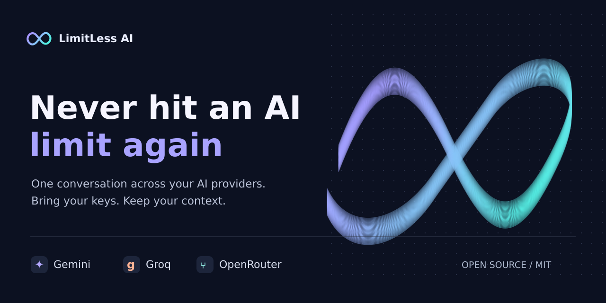
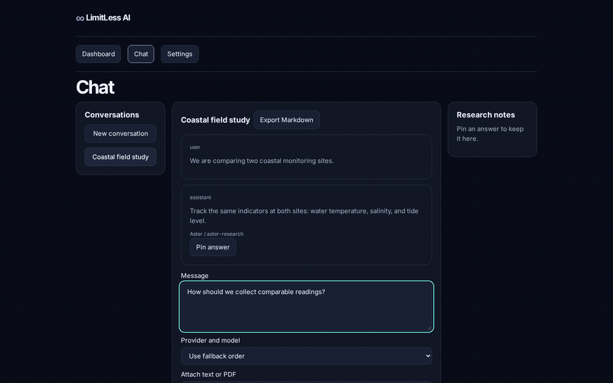
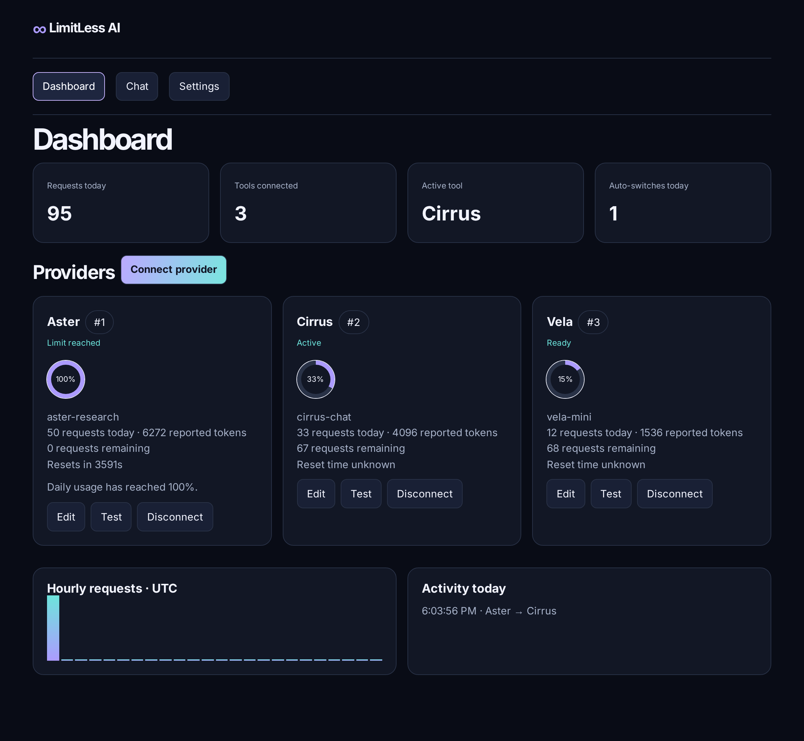
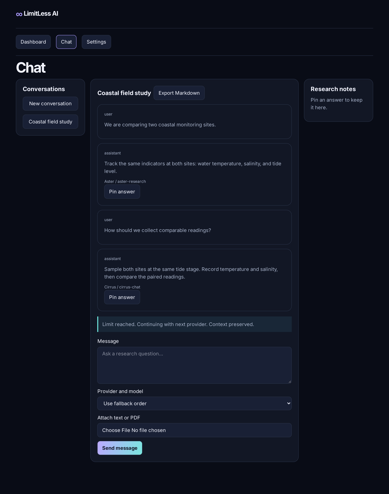
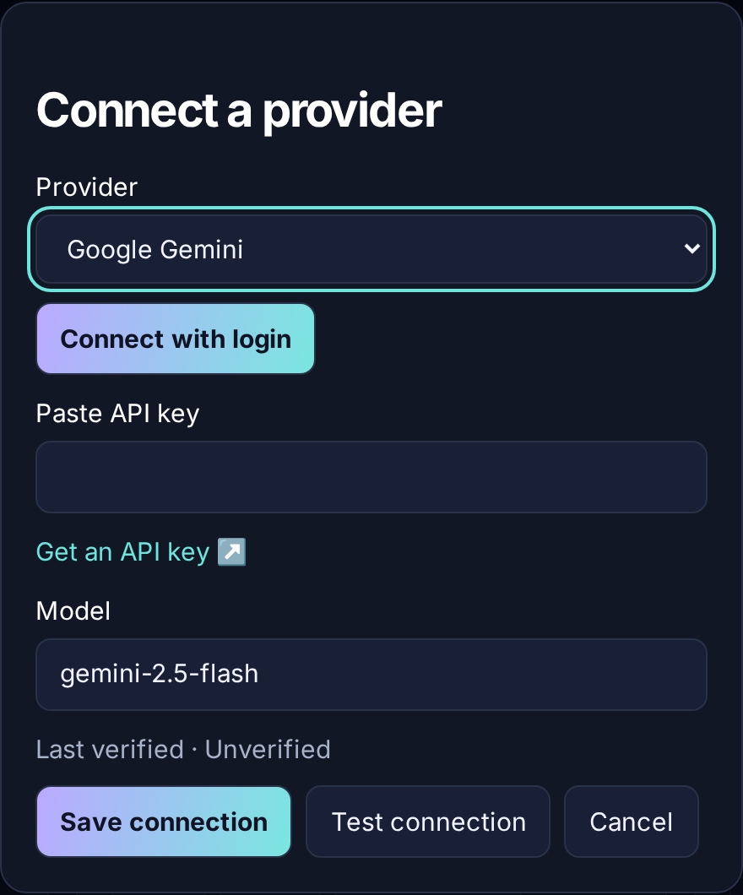
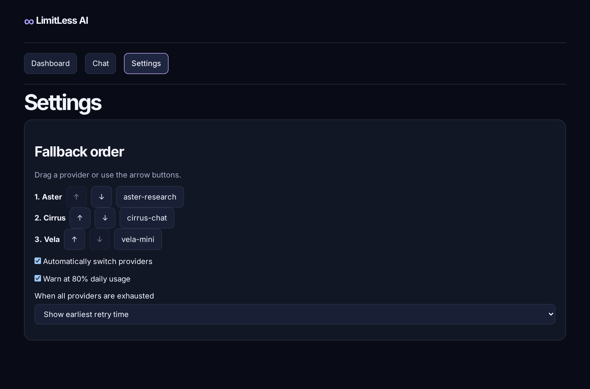
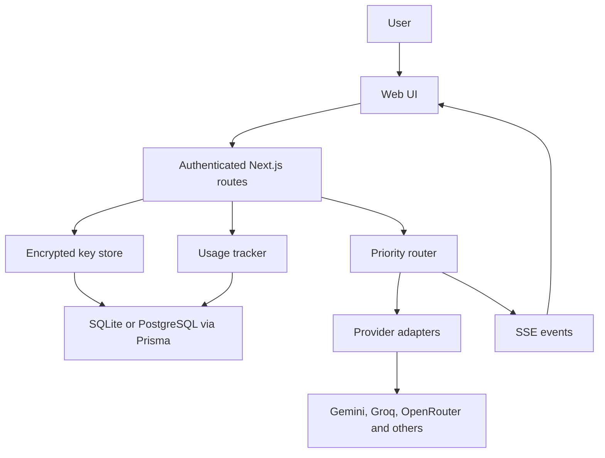

<p align="center"></p>

# LimitLess AI — self-hosted AI router

[](LICENSE) [](https://github.com/itspsr/limitless-ai/actions/workflows/ci.yml) [](https://github.com/itspsr/limitless-ai/stargazers) [](CONTRIBUTING.md) [](#docker-self-host)

**LimitLess AI** is a free, open-source AI router and research workspace. Connect Gemini, Groq, OpenRouter, and other providers with your own API keys. When a provider reaches its rate limit, LimitLess AI continues the chat on the next provider with the full conversation history.

Connect official API credentials, set a fallback order and see which provider answered each turn. The MIT-licensed app has no subscriptions, analytics or required cloud account. Your provider's own terms and usage charges still apply.

## Demo



This 12-second recording uses fictional providers and a simulated HTTP 429. The running app routes the original thread to the second provider.

To try the workspace, connect a provider from the dashboard, open Chat and send a question. To see a repeatable fallback without credentials, run `pnpm test`. The router test simulates a 429 on A and checks that B receives the complete conversation.

## Screenshots

| Provider dashboard | Chat after a switch |
| --- | --- |
| [](docs/images/dashboard.png) | [](docs/images/chat-autoswitch.png) |
| **Connect a tool** | **Set fallback order** |
| [](docs/images/connect-tool.png) | [](docs/images/fallback-order.png) |

Select a screenshot for full resolution. To regenerate the app captures, install FFmpeg, run the quick-start install command below, then run `pnpm screenshots`. The script starts a separate dev server and seeds a temporary SQLite database.

## Quick start

Install Node.js 24 and pnpm 11.25.0. From the project directory:

```sh
pnpm install --frozen-lockfile
pnpm dev
```

Open http://localhost:3000, select **Open workspace**, then **Register**. Startup initializes SQLite and generates persistent secrets automatically. The dev server binds to loopback. To use your existing keys, choose a provider and paste its API key. **Test connection** sends a short real model request and may count against quota.

## Docker self-host

```sh
docker compose up --build
```

Open http://localhost:3000. The named volume holds the SQLite database and generated secrets. Stop with `docker compose down`. Keep the volume when upgrading. For a personal loopback deployment, use `SINGLE_USER=true docker compose up`. This setting grants every visitor access to the same workspace. Back up the volume or your database and encryption secret together.

## Features

- Full-history fallback on throttling, upstream failures and timeout. Interrupted drafts are replaced when another provider takes over.
- SSE chat with Markdown, code blocks, provider and model attribution, text/PDF attachments, pinned answers and Markdown export.
- Daily and minute usage buckets, provider-reported capacity, cooldowns, local quota estimates and an activity feed.
- Drag or use arrow buttons to order connections. Edit quotas and models, disable automatic switching or enable an 80% daily-request warning.
- Email/password accounts using Auth.js, plus optional single-user hosting. Provider authorization is separate from signing into the workspace.

## Providers

The registry in [providers.json](packages/providers/providers.json) is the source of truth. Model names are editable presets. An unverified field means the provider or account needs checking. Trial credits, regional eligibility and access can change.

| Provider | Connection | Setup |
| --- | --- | --- |
| Google Gemini | API key or Google OAuth | [AI Studio](https://aistudio.google.com/apikey) |
| Groq | API key | [Groq Console](https://console.groq.com/keys) |
| OpenRouter | API key or PKCE login | [OpenRouter](https://openrouter.ai/keys) |
| Mistral | API key | [La Plateforme](https://console.mistral.ai) |
| Cloudflare Workers AI | API token and account ID | [Cloudflare](https://dash.cloudflare.com) |
| NVIDIA API Catalog | API key | [NVIDIA](https://build.nvidia.com) |
| Cerebras | API key | [Cerebras](https://cloud.cerebras.ai) |
| Cohere | API key | [Cohere](https://dashboard.cohere.com/api-keys) |
| SambaNova | API key | [SambaNova](https://cloud.sambanova.ai) |
| Custom OpenAI-compatible API | API key, HTTPS endpoint and model | Host operator enables its domain |

## Configuration

Copy .env.example to .env to override local defaults. The server reads these settings.

| Variable | Purpose |
| --- | --- |
| DATABASE_URL | SQLite file URL or PostgreSQL connection URL. Set before build and startup. |
| ENCRYPTION_SECRET | 32 random bytes encoded as 64 hex characters. Generate with `node scripts/generate-secret.mjs`. |
| AUTH_SECRET | Independent random Auth.js signing secret. Generate separately. |
| AUTH_URL | Canonical public origin, including scheme and port. Use HTTPS on a shared host. |
| SINGLE_USER | Defaults to false. Enable only on a private host. |
| CUSTOM_PROVIDER_HOSTS | Comma-separated approved HTTPS hosts including port if nonstandard. |
| GOOGLE_CLIENT_ID, GOOGLE_CLIENT_SECRET, GOOGLE_PROJECT_ID | Enable Google provider login. Register the callback at your origin plus /api/connect/gemini and enable the Gemini API in the project. |

OpenRouter uses PKCE and a callback at /api/connect/openrouter. Google stores an encrypted refresh credential. Provider authorizations grant the host access to call those APIs. Hosting requires a trusted operator.

For a Node-compatible host with ephemeral disk (including serverless deployments), provision PostgreSQL, persistent secrets and AUTH_URL. Run `pnpm db:setup` in a writable build environment, then `pnpm build`. For Vercel select Next.js with apps/web as the root, include workspace sources outside the root, and use `cd ../.. && pnpm db:setup && pnpm --filter @limitless/web build` as the build command. For a long-running container use the Dockerfile. Streaming duration, function size, database availability and free-plan allowances depend on the host. Hosted deployment has not been validated.

## How it works

### Architecture



[View the architecture diagram as a PNG](docs/images/architecture.png).

See [architecture](docs/architecture.md) and [adding a provider](docs/adding-a-provider.md).

## Why BYOK is safe

Credentials are encrypted using AES-256-GCM with a new nonce per encryption and the user ID as authenticated data. Saved keys are omitted from browser responses. The host decrypts a key to contact its intended API. Keep your host and backups private. Conversation text, extracted attachments and pinned answers are stored as ordinary database records. Every provider used for a reply receives the whole thread.

## FAQ

**Can I connect a consumer chat subscription?** Connect official developer APIs only. The app does not scrape or automate ChatGPT, Claude.ai or Gemini consumer sites and does not rotate accounts to bypass limits.

**What happens when every provider is exhausted?** Chat stops and retains the conversation. By default it shows the earliest known retry time. You can change the notification in Settings.

**Can all providers handle any conversation?** Their context windows differ. The router sends the full history. An upstream request-validation error can require choosing another model or starting a shorter thread.

**Are counters an account-wide balance?** Local counts describe this workspace. Where available, upstream headers reflect provider activity. Token reporting varies by API. Limits are estimates and are editable.

## Roadmap

- Expand verified provider and model fixtures with opt-in live smoke tests.
- Add tokenization for provider-specific context preflight and more quota-header formats.
- Add migration tooling for moving an existing SQLite workspace to PostgreSQL.

See [contributing](CONTRIBUTING.md), [community conduct](CODE_OF_CONDUCT.md), [security](SECURITY.md) and the [MIT License](LICENSE).
